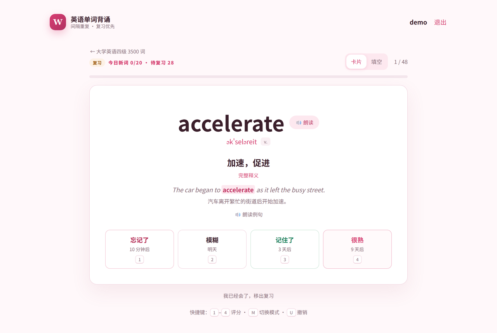
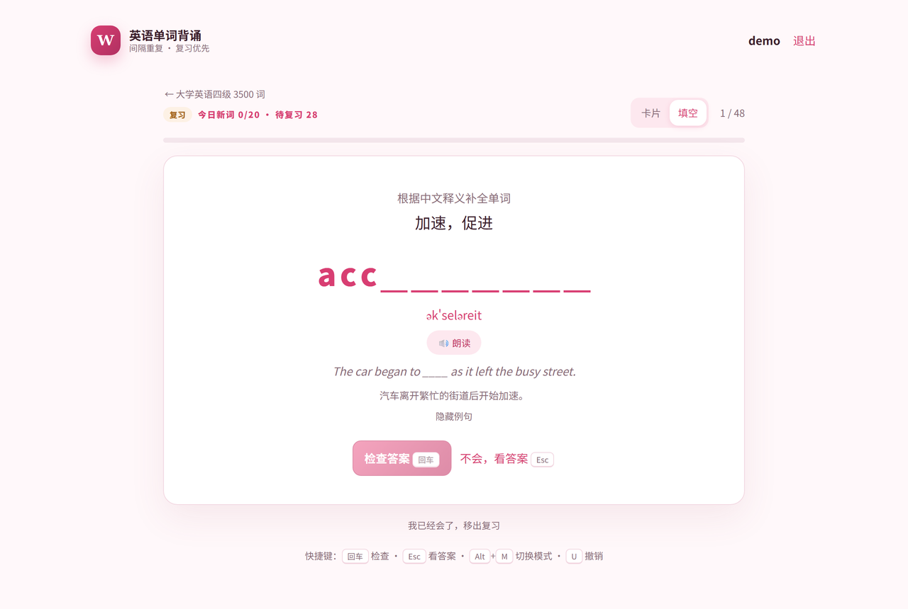
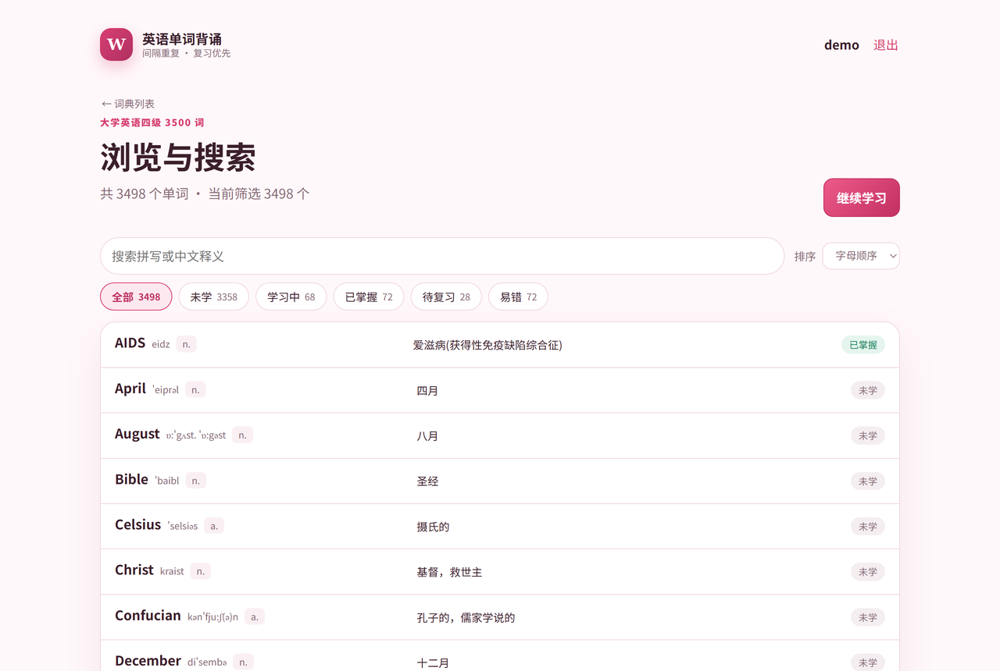
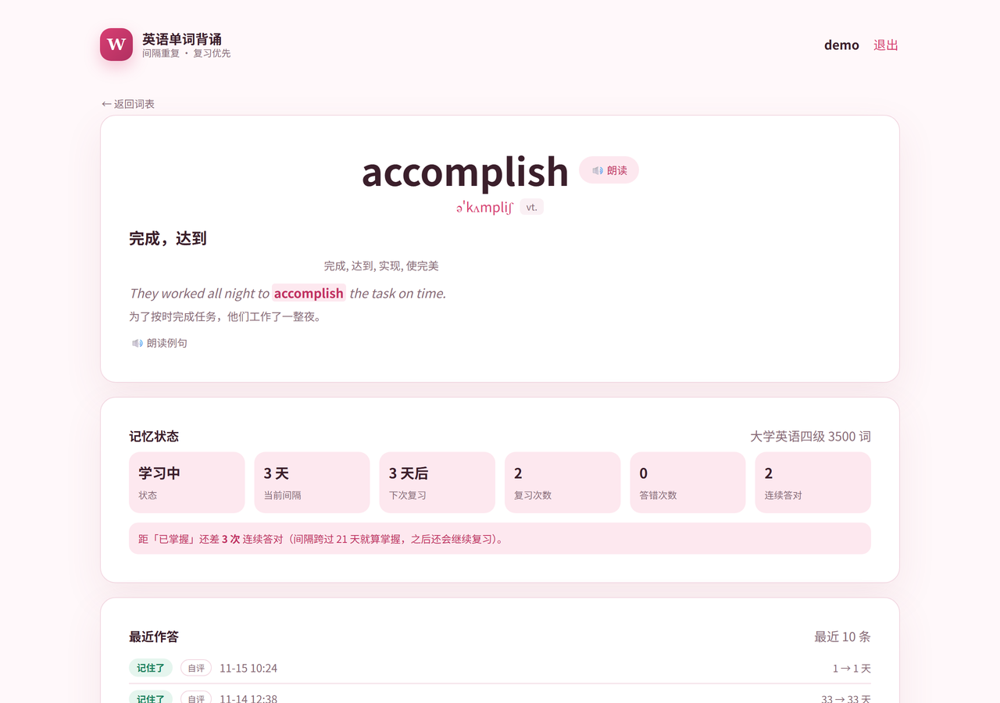
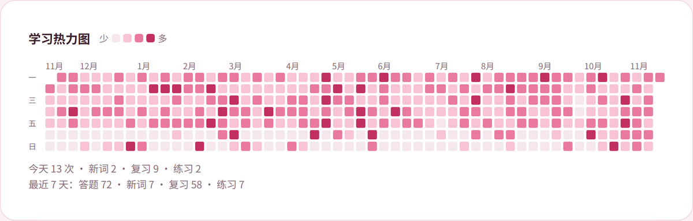
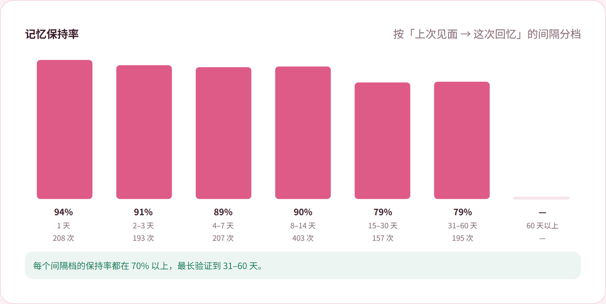
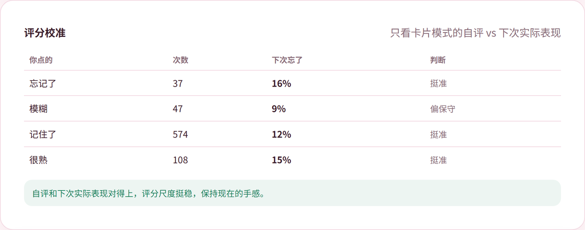
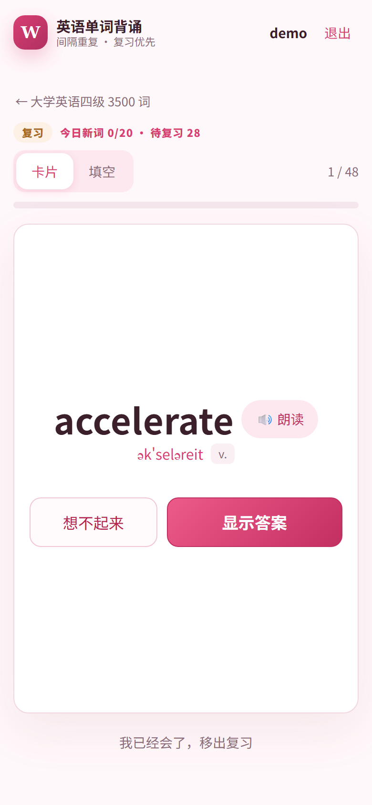
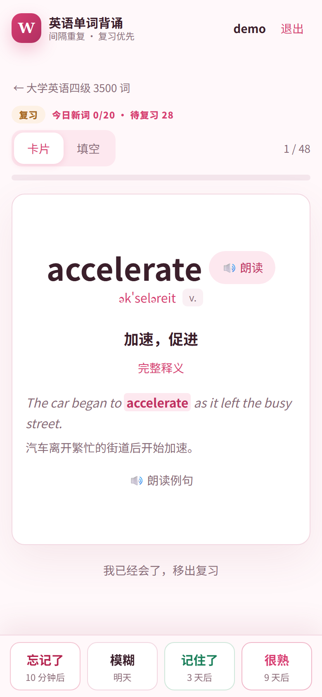
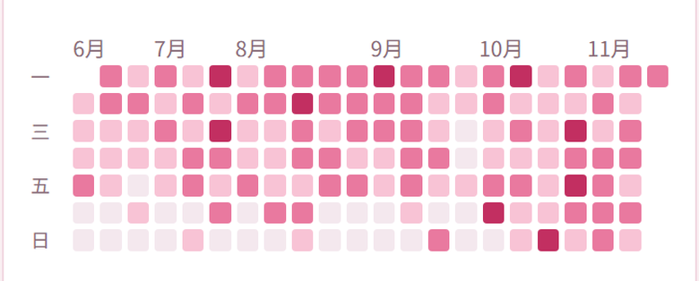

# 英语单词背诵 · English Vocabulary

> 一个把「背单词」当成**记忆工程**而不是打卡任务来做的背单词应用。
> 什么时候该复习由调度器算，有没有想起来由证据判断，你只负责诚实。

<p>


</p>

**在线体验**：<http://47.117.171.160/> （注册即用，手机浏览器可直接打开）　·　**源码**：<https://github.com/pridelizihao/english-vocabulary-web>



---

## 为什么是它，而不是又一个背单词网站

大多数背单词工具做的是两件事：给你一个词表，给你一个「记住了/没记住」的按钮。剩下的全靠自觉。

这个项目在三个地方做了不一样的选择，它们决定了「复习量会不会雪崩」「评分还可不可信」：

### 1. 卡片正面不止一个按钮


正面有两条路：

- **想不起来**（`1`）——直接看答案，这一题记「忘记了」，10 分钟后再来，**不再给评分按钮**。
- **显示答案**（`空格`）——你真的想起来了，核实释义后再自评 1–4。

早先的版本只有「显示答案」一个按钮。看起来没区别，实际有个隐蔽后果：想诚实地说「我不会」没有入口，只能先点开答案；而答案已经在眼前，再让你选四档，**「记住了」几乎是最顺手的那个**。

这是真实用户数据里查出来的：改用双按钮前，那个账号的一百多条作答里 `忘记了` 出现了 **0 次**。不是记性好，是没给机会。

### 2. 填空模式的评分由服务器算，不由你点

填空是「给中文释义，补全拼写」，它天然带客观证据——**你错了几次、有没有点「看答案」**。所以这一模式的评分不给用户：

| 你的表现 | 判定 | 后果 |
| --- | --- | --- |
| 一次就写对，没看答案 | 记住了 | 间隔 1 天 |
| 错一次后写对 | 模糊 | 间隔 ×1.2 |
| 点了「看答案」，或错两次以上 | **忘记了** | 间隔归零，10 分钟后再来 |

关键一条：**看过答案就锁死为「忘记」**。之后点「再试一次」写对，也不能洗白——否则「偷看 → 重试 → 评记住了」就是最短的作弊路径。

这一条保证 `streak`（连对次数）只认真正想起来的时刻，而 `streak` 正是判断「能不能归档」的依据。

### 3. 新词额度会自己缩手

「每天 20 个新词」是个好口号，但配上「单次最多 50 个复习」在数学上追不上：

```
每天 20 个新词、全部答对 → 日复习量的峰值是 120 个
而队列一次只放 50 个
⇒ 从第 6 天起就开始积压，而且逾期词按「最久没复习优先」排序，
   它们天天到期、天天霸占前 50 个名额，越拖越多
```

所以额度跟着复习量收口：

| 当天到期复习 | 给多少新词 |
| --- | --- |
| < 40 个 | 20 个（满额） |
| ≥ 40 个 | 10 个 |
| ≥ 80 个 | 0 个，今天专心清复习 |

学满 3498 词时，每天 6 个新词的峰值是 42 个复习，每天 20 个则是 120 个 —— 想长期跑下去，前者才撑得住。

---

## 功能一览

### 学习

| | |
| --- | --- |
| **双模式** | 卡片（看词想义）与填空（看义拼词），`M` 随时切换；填空框里用 `Alt+M`，这样 `m` 仍然是字母 |
| **四档评分** | 忘记 / 模糊 / 记住 / 很熟，每个按钮上直接写「下次什么时候见」 |
| **证据留痕** | 每题记录作答方式、试错次数、是否看过答案，词详情里能看到「自评 / 填空 / 看答案 · 错 2 次」 |
| **撤销** | 评错了 10 分钟内按 `U` 撤销，间隔和统计一起回退 |
| **标为已会** | 认识的词一键移出复习队列，标错了同样能撤销 |
| **朗读** | 单词与整句都能读；优先系统英文语音，没有则用服务器合成的音频（首次约 1.5–3 秒，之后命中缓存） |

### 调度

| | |
| --- | --- |
| **间隔** | `good` 走 1 → 3 → 7 → 19 → 52 天，之后 ×ease；`easy` 更快，`hard` ×1.2，`again` 归零 |
| **已掌握** | 间隔跨过 21 天才算，答错会掉回来 |
| **归档** | 间隔 ≥ 180 天或连对 ≥ 8 次，移出每日队列（仍留在词表，可手动「重新学习」） |
| **复习队列** | 到期优先，单次最多 50 个；另有「提前复习」和「错词练习」两条练习通道，不改间隔 |
| **新词顺序** | 默认按 CEFR：B1 → B2 → C1 → 未收录 → A2 → A1，专有名词垫底；同档内按天打乱（同一天刷新顺序稳定，隔天换） |

### 浏览与数据

| | |
| --- | --- |
| **词表** | 搜索拼写/释义，按 全部/未学/学习中/已掌握/待复习/易错 筛选，四种排序，状态同步在 URL 里 |
| **单词详情** | 音标、完整释义、例句、记忆状态、最近 10 次作答，以及**「距已掌握还差几次」** |
| **学习面板** | GitHub 风格全年热力图、连续天数、按词典分布 |
| **保持率** | 按「上次见面 → 这次回忆」的间隔分档，直接告诉你哪一档开始掉到 70% 以下 |
| **评分校准** | 统计你自己的「自评 vs 下次实际表现」，判断偏乐观还是偏保守（只统计卡片自评） |

---

## 界面

### 桌面

<table>
<tr>
<td width="50%"><b>选词典</b><br></td>
<td width="50%"><b>填空模式</b><br></td>
</tr>
<tr>
<td><b>词表浏览</b><br></td>
<td><b>单词详情</b><br></td>
</tr>
</table>

### 数据面板



<table>
<tr>
<td width="50%"><b>记忆保持率</b>——哪一档间隔开始失效<br></td>
<td width="50%"><b>评分校准</b>——你自评准不准<br></td>
</tr>
</table>

### 手机

手机不是把桌面缩小：评分按钮吸在屏幕底部（拇指够得到）、一屏一题、软键盘答完即收、键盘提示自动隐藏。

<p>



</p>

---

## 技术栈

**后端** Django 5.2 · Django REST Framework · SQLite · `edge-tts`（例句语音合成）
**前端** Vue 3.5 · Vite 6 · TypeScript 5.6 · 零 UI 框架（样式手写，图表用 SVG）
**部署** gunicorn + nginx + systemd（Ubuntu 24.04 实测），也提供 Docker Compose

```
浏览器
  │  SPA（hash 路由，单文件部署）
  ├─────────────► nginx
  │                 ├── /            → 前端静态产物
  │                 ├── /api/*       → 反代 gunicorn
  │                 └── /static/*    → Django admin 静态资源
  ▼
gunicorn (2 workers)
  └── Django REST Framework
        ├── 调度器 services.schedule()     ← 间隔、ease、归档判定
        ├── 证据判定 derive_cloze_rating() ← 填空评分
        ├── 额度收口 adaptive_new_limit()  ← 新词是否缩手
        └── SQLite（单文件，便于备份）
```

### 一些有意为之的取舍

- **前端零依赖**：没有 Vue Router、没有 Pinia、没有图表库。路由是一个 67 行的 hash 解析器，图表是 150 行坐标计算——换来的是约 60 KB（gzip）的整站体积和可测的纯函数。
- **纯逻辑全部抽成函数**：填空遮罩、队列、热力图分档、图表坐标、浮层定位都在 `frontend/src/lib/`，用 `node:test` 直接测，不启动浏览器。
- **不做「正确的感觉」，做可查的证据**：界面上的每个数字都能在 `AnswerLog` 里追到原始记录。
- **服务端说了算**：填空评分、每日额度、归档判定都在后端，客户端只提交事实（对错、错几次、看没看答案）。

---

## 快速开始

### 后端（Python 3.12+）

```bash
cd backend
python -m venv ../.venv                      # 仓库根目录的 .venv
../.venv/bin/pip install -r requirements.txt
../.venv/bin/python manage.py migrate
../.venv/bin/python manage.py seed_dictionaries
../.venv/bin/python manage.py seed_wordlists  # 导入 3500 / 5000 词并发布
../.venv/bin/python manage.py createsuperuser  # 可选，用于 /admin
../.venv/bin/python manage.py runserver
```

Windows 把 `../.venv/bin/python` 换成 `..\.venv\Scripts\python.exe` 即可，项目文档里两种写法都有。

### 前端（Node 20+）

```bash
cd frontend
npm install
npm run dev
```

打开 <http://localhost:5173>，注册后就能开始。Vite 会把 `/api` 代理到 `http://127.0.0.1:8000`，后台在 <http://127.0.0.1:8000/admin/>。

### 想先看看数据长什么样

自带的演示数据生成器会造一个「学了一年」的账号——热力图、保持率曲线、评分校准都有内容，不用自己背几天再截图：

```bash
cd backend
../.venv/bin/python manage.py seed_demo            # 账号 demo / Demo12345678
../.venv/bin/python manage.py seed_demo --reset    # 重来一遍
```

它只写 `demo` 这个账号，不碰其他用户；固定随机种子，所以每次结果可复现。

---

## 测试

```bash
cd backend && ../.venv/bin/python manage.py test    # 110 个用例
cd frontend
npm run typecheck                                  # tsc --noEmit
npm run test                                       # 51 个纯逻辑用例（node:test）
npm run build                                      # 产物在 dist/，部署机不需要 Node
```

后端覆盖调度边界、归档门槛、幂等重放、撤销快照、导入解析、验证码限流；前端覆盖填空遮罩、队列重排、热力图分档、图表坐标、浮层定位。

---

## 部署

原生部署（nginx + gunicorn + systemd）的完整步骤见 [`docs/deploy.md`](docs/deploy.md)，配置模板在 `deploy/`。仓库里还有一个一键更新脚本：

```bash
# 服务器上，拉代码 → 备份库 → 迁移 → collectstatic → 铺前端 → 重启 → 自检
bash /opt/english-vocabulary/deploy/update.sh
```

`update.sh` 从服务器上的裸仓库拉取，所以本仓库配了两个远端：`github` 是公开镜像，`origin` 是那台服务器（部署源）。两边一起推：

```bash
bash deploy/publish.sh    # 先推 github，再推 origin
```

也可以用 Docker：

```bash
cp .env.example .env    # 填写 DJANGO_SECRET_KEY 等
docker compose up --build
```

访问 <http://localhost:8080>。容器启动时自动 migrate、创建官方词典、导入 `data/imports` 并 collectstatic。

> 开发机没有 Docker，镜像配置尚未实机验证；如果启动失败，优先检查卷挂载与 `DJANGO_ALLOWED_HOSTS`。

---

## 导入自己的词表

页面上的「导入个人词典」支持 CSV / JSON / XLSX，自动去重、只有自己可见。也可以走接口：

```bash
curl -X POST http://127.0.0.1:8000/api/dictionaries/import \
  -b cookies.txt -H "X-CSRFToken: ..." \
  -F "name=我的词表" -F "file=@data/samples/words.csv"
```

字段至少包含 `word` 和 `meaning`，可选 `phonetic / part_of_speech / example / example_translation / audio_url / cefr`。
支持 UTF-8 与 GBK 的 CSV、JSON 数组、XLSX；同一个词（忽略大小写）只保留一条。

官方词典（需要 staff）用：

```bash
python manage.py import_dictionary --dictionary "词典名" --file data/imports/xxx.csv --publish
```

---

## 例句与语音

`data/examples.json` 里存着 4998 条例句和中文翻译，卡片作答后显示，填空模式里作为「遮罩提示」（目标词先被遮住）。

```bash
python manage.py enrich_examples              # 只补空的
python manage.py enrich_examples --force      # 覆盖全部
python data/scripts/build_wordlists.py        # 把例句写回可导入的 CSV
```

例句是项目生成的短句（贴合释义、带中文翻译），不是从受版权保护的词典里抓的；要换成正式授权语料，按同样格式重写 `data/examples.json` 再执行上面的命令。

**整句朗读**走服务器合成（`edge-tts`，`en-US-AriaNeural`），按句子哈希缓存成 MP3，第二次播放基本瞬时。句子会发给 Microsoft 的语音服务；单词发音优先用设备本地语音，没有语音包时才请求有道在线发音（只发当前这个单词，不涉及账号或学习数据）。

---

## 数据来源

`data/sources/README.md` 记录了词表来源与授权提示。`data/imports/` 里的 3500 / 5000 词是按字母序截取的核心子集，**不代表官方考纲词量**；商用或再分发前请确认上游许可。

CEFR 等级来自 Oxford 3000/5000，覆盖了约三分之二的 CET 词；查不到等级的词在「考试核心」顺序里排在 C1 之后、A2 之前。

---

## 目录结构

```
backend/                     Django 项目
  config/                    settings / urls / wsgi
  vocabulary/
    models.py                Dictionary / Word / UserWordProgress / AnswerLog …
    services.py              调度器、证据判定、额度收口、导入解析
    views.py                 HTTP 层（函数视图为主）
    email_codes.py           邮箱验证码：哈希存储、冷却、频率限制
    tests.py                 110 个用例
    management/commands/     seed_dictionaries / seed_wordlists / seed_demo / import_dictionary / enrich_examples / annotate_cefr
frontend/
  src/api.ts                 唯一请求入口（CSRF、超时、中文错误兜底）
  src/lib/*.ts               纯逻辑：填空、队列、热力图、图表、词表查询
  src/views/*.vue            Auth / Dictionaries / Words / WordDetail / Study / Done / Profile
  src/composables/           会话状态、朗读链路
  tests/*.test.mjs           51 个纯逻辑用例
data/                        词表来源、可导入 CSV、例句、生成脚本
deploy/                      systemd unit、nginx 站点、一键更新脚本
docs/                        部署说明、设计文档、界面截图
AGENTS.md                    给后续开发/AI 代理的约定与踩坑清单
```

`docs/screenshots/` 里的图片由 `seed_demo` 生成的数据实拍而来，改动界面后按同样流程重拍即可。

---

## 已知限制

- 例句与释义仍是项目生成 / ECDICT 原始多义项，不是授权词典语料。
- 移动端只在 headless Chrome 的手机模拟里验证过（390×844、320×568），**没在真机上跑过**；iOS 软键盘顶起时吸底条的位置、地址栏收起引起的 `dvh` 变化，尚未实测。
- 还不是 PWA：没有 Service Worker，不能离线用，也没有每日提醒——这是留存上最大的缺口。
- SQLite 单文件；要上多实例或高并发前需要先换 PostgreSQL。
- 复习上限 50 个/次是常量，暂不可在界面上调整。

## 路线图

- [ ] 每日提醒（邮件 / Web Push）与 PWA 离线
- [ ] 按个人保持率回灌调度参数（现在的 ease 还是通用规则，没用上你自己的曲线）
- [ ] 复习上限可调、逾期词单独入口
- [ ] 词表导出与分享

---

## 许可

代码以 [MIT](LICENSE) 发布——可以拿去做自己的背单词工具、改商用都行，保留版权声明即可。

`data/` 里的词表不属于这个 MIT 授权：`data/sources/` 的 CET 词表与中文释义来自 [imfiiish/wordlists](https://github.com/imfiiish/wordlists)（释义源自 ECDICT），CEFR 等级来自 Oxford 3000/5000 派生数据，`data/examples.json` 的例句是本项目自己写的。**再分发或商用前请自行确认上游许可**，细节见 [`data/sources/README.md`](data/sources/README.md)。

---

<sub>截图对应的演示数据由 `manage.py seed_demo` 生成；界面文案全中文，错误信息优先展示后端 `detail`。</sub>
